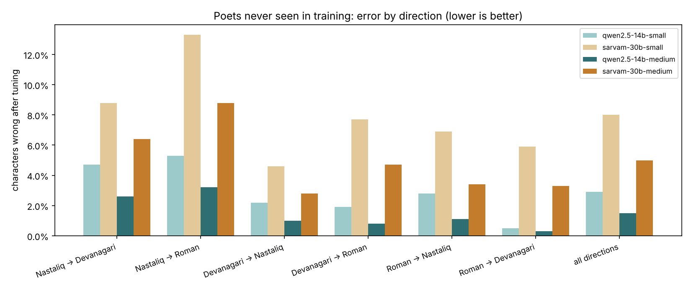
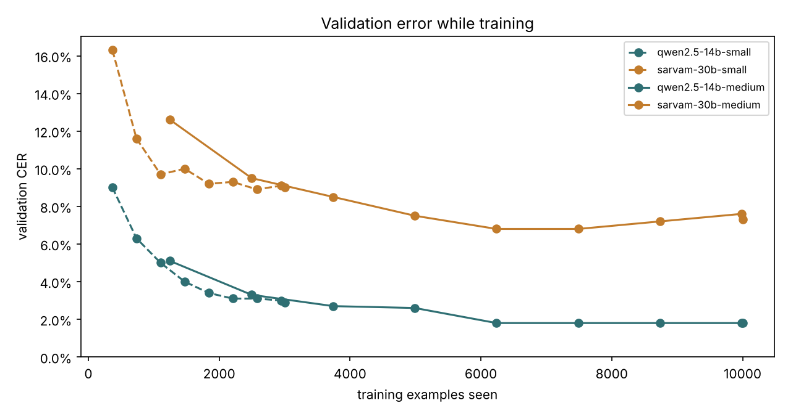

# zameen

**Fine-tune and evaluate language models that move Urdu poetry between Nastaliq, Devanagari and Roman, the way Rekhta writes it.**

Rekhta publishes every ghazal three times: in Nastaliq (Urdu script), in Devanagari and in Roman.
Producing the second and third versions is skilled editorial work. zameen turns Rekhta's existing
three-script corpus into training data, fine-tunes an open model with LoRA, and measures it before
and after on poems, and poets, it never saw.

On the public Rekhta sample, a LoRA adapter on **Qwen2.5-14B** trained on 10,000 examples takes
transliteration from **23.5% of characters wrong to 1.5%** on poets held out of training, and from
**under 1% of shers exactly right to 55%**. It keeps the radif in 98% of transliterated matlas.

> The name: in a ghazal, the *zameen* is the shared ground of meter, radif and qafiya that every sher stands on.

---

## Contents

1. [Results](#1-results)
2. [Quick start (any computer, no GPU)](#2-quick-start-any-computer-no-gpu)
3. [Running on a GPU](#3-running-on-a-gpu)
4. [Running on Google Colab](#4-running-on-google-colab)
5. [Trained models: placeholders for the adapters on Google Drive](#5-trained-models-placeholders-for-the-adapters-on-google-drive)
6. [Using Rekhta's full corpus](#6-using-rekhtas-full-corpus)
7. [How it works](#7-how-it-works)
8. [Reproducing the results](#8-reproducing-the-results)
9. [Command reference](#9-command-reference)
10. [Configuration reference](#10-configuration-reference)
11. [Repository layout](#11-repository-layout)
12. [Troubleshooting: lessons from the runs](#12-troubleshooting-lessons-from-the-runs)
13. [Next experiments](#13-next-experiments)
14. [Development](#14-development)
15. [Data, licenses and acknowledgments](#15-data-licenses-and-acknowledgments)

---

## 1. Results

Four runs on one A100 80 GB (bf16), identical data, splits, prompts and metrics. Each cell is
*familiar poets / poets never seen in training*. CER is the share of characters wrong (lower is
better); exact is the share of shers transliterated perfectly.

| Run | Training examples | CER before | **CER after** | **Exact shers after** | Radif kept | Qafiya kept | Training time | Whole run |
|---|---|---|---|---|---|---|---|---|
| Qwen2.5-14B, small | 3,000 | 25.1 / 23.3% | 4.3 / 2.9% | 24.0 / 31.9% | 93 / 97% | 68 / 79% | 17 min | 37 min |
| Sarvam-30B, small | 3,000 | 48.8 / 52.1% | 10.6 / 8.0% | 5.8 / 11.0% | 87 / 90% | 49 / 58% | 99 min | 2 h 30 |
| **Qwen2.5-14B, medium** ★ | 10,000 | 24.6 / 23.5% | **2.1 / 1.5%** | **48.1 / 54.8%** | 97 / 98% | 81 / 88% | 43 min | 1 h 28 |
| Sarvam-30B, medium | 10,000 | 51.1 / 51.2% | 6.5 / 5.0% | 13.9 / 21.8% | 90 / 93% | 56 / 68% | 5 h 04 | 6 h 46 |

★ recommended. Full tables per direction, word accuracy by spelling feature, validation curves and
timings for each run are in [`results/`](results/); the side-by-side is
[`results/comparison.md`](results/comparison.md).





### What the runs show

* **Fine-tuning works, and it generalizes to new poets.** Every direction improves for both
  models. Error on the two held-out poets (Jigar Moradabadi, Waseem Barelvi) is as low as on
  familiar ones, so the model learned the conventions, not the poems.
* **More data helps, up to a point.** From 3,000 to 10,000 examples, Qwen's perfect shers doubled
  (32% → 55% on new poets). Both models' validation error levels off near 6,000 examples.
* **The general model beat the Indic model.** At equal data, Sarvam-30B made 2.5–2.8× more
  character errors (3,000 examples) and 3.1–3.3× more (10,000). Sarvam trained on 10,000 is still
  behind Qwen trained on 3,000. Its tokenizer is far more efficient (1.35 pieces per Nastaliq word
  against Qwen's 2.79), yet reading Nastaliq stayed its weakest direction. Likely reasons, each
  testable: its adapter trains about 7× fewer parameters (attention and the shared expert only;
  the 128 routed experts stay frozen); its base model answers in the wrong script 24–29% of the
  time before tuning; and it sometimes swaps in a synonym (बूंद, Hindi for "drop", for क़तरे),
  which suits translation but not transliteration.
* **The biggest remaining gaps are Rekhta's house conventions.** With 10,000 examples, Qwen writes
  83% of words with Rekhta's capital-letter retroflex in Roman exactly right; Sarvam 38%. Izafat in
  Devanagari: 70% against 35%.
* **Cost.** Sarvam's checkpoint is ~129 GB against ~30 GB, needs 64 GB of GPU memory, and trained
  6–7× slower despite only ~2.4 B active parameters per token.

**Verdict for transliteration today: Qwen2.5-14B**, open weights (Apache 2.0), small adapter,
standard code. Keep the harness model-neutral and re-test new Indic models as they appear.

### The task in one example

Ghalib, read in Nastaliq, written in Devanagari (instruction in Roman Urdu, as in training):

```
Is sher ko Devanagari mein likhiye. Har lafz barqaraar rakhiye; sirf sher, do misron mein, likhiye.

آ کہ مری جان کو قرار نہیں ہے
طاقت بیداد انتظار نہیں ہے
```
```
आ कि मिरी जान को क़रार नहीं है
ताक़त-ए-बेदाद-ए-इंतिज़ार नहीं है
```

Going *from* Nastaliq means restoring short vowels, izafat (ताक़त-**ए**-बेदाद) and nasalization that
the script leaves unwritten; going *to* Nastaliq means choosing between letters the other scripts
don't distinguish (س / ص / ث, ز / ذ / ض / ظ). That is why this is learned rather than rule-based.

---

## 2. Quick start (any computer, no GPU)

Python 3.10 or newer. Everything except training and model evaluation runs on a laptop.

```bash
git clone https://github.com/ukamathAppliedML/zameen.git
cd zameen
python -m venv .venv
source .venv/bin/activate            # Windows: .venv\Scripts\activate
pip install -e ".[dev]"

pytest                               # 52 tests, under a minute
zameen smoke                         # the whole pipeline in seconds, with a stand-in model
zameen data --size medium            # downloads the public sample once, prints split statistics
```

`zameen smoke` runs every stage (datasets, preflight, baseline, training with a validation curve,
tuned evaluation, reports) with the **oracle** backend: a deterministic stand-in that knows the
gold answers and improves as it "trains". Its numbers mean nothing about any model; it proves the
plumbing works before you rent a GPU. It writes a complete run folder to `runs/smoke/`.

In VS Code: open the folder, select `.venv` as the interpreter, and the Testing panel picks up the
tests from `pyproject.toml`.

---

## 3. Running on a GPU

### Hardware

| Model | GPU | Precision | Disk | Medium run (10,000 examples) |
|---|---|---|---|---|
| Qwen2.5-14B ★ | A100 80 GB (or H100) | bf16, ~30 GB | ~35 GB | ~1.5 h |
| Qwen2.5-14B | A100 40 GB / L40S | 4-bit automatically | ~35 GB | ~2 h |
| Qwen2.5-7B | 24–40 GB (L4, A10, A100 40 GB) | bf16 or 4-bit | ~20 GB | ~1 h |
| Sarvam-30B | A100 80 GB | bf16, ~64 GB | **~140 GB** | ~7 h |

Precision is chosen from GPU memory (`quantization: auto`); force it with `quantization: 4bit` or
`none`. Any CUDA machine works: a workstation, a cloud VM (Lambda, RunPod, GCP, AWS), or Colab.

### Install

```bash
python -m venv .venv && source .venv/bin/activate
pip install -e ".[train]"            # Qwen and most models
# or, for Sarvam-30B (its custom code needs transformers 4.x):
pip install -e ".[sarvam]"
pip uninstall -y torchao             # only if installed: old torchao breaks recent peft
zameen doctor --model qwen2.5-14b    # checks GPU, versions and known conflicts
```

Use a separate virtual environment for Sarvam: the two extras pin different transformers versions.
`make install-train` / `make install-sarvam` do the same.

### Run

```bash
zameen run -c configs/qwen2.5-14b-medium.yaml
```

That is the whole experiment: load the corpus, build the datasets, load the model, preflight,
baseline evaluation, LoRA training with a validation curve, tuned evaluation, reports. Progress
prints as it goes, with ETAs:

```
▶ training · 10000 examples × 1 epoch(s)  [20:41:28]
[val] step 78/625 · seen 1,248 · CER 5.1% · exact 20% · from Deva=3.3% Nast=9.5% Roma=2.2% ★ best · ETA 37m
```

For long runs on a remote machine, use `tmux` (or `nohup`) so a dropped SSH session doesn't stop
it. **Runs resume:** if anything interrupts, run the same command again. Evaluation picks up from
the last saved prediction, training from the last checkpoint (saved at every validation point),
and a finished training is reused rather than repeated.

Override anything from the command line or a config file:

```bash
zameen run -c configs/sarvam-30b-small.yaml --n-train 5000 --run-name sarvam-5k
zameen run --model qwen2.5-7b --size small
```

### What a run writes

```
runs/qwen2.5-14b-medium/
├── config.yaml               the exact settings used
├── progress.jsonl            every stage with its duration
├── predictions_base.jsonl    every test prompt: raw output, extracted answer, all scores (before)
├── predictions_tuned.jsonl   the same after fine-tuning
├── validation_curve.csv      validation error against examples seen
├── adapter/                  the trained LoRA adapter (the best validation checkpoint)
├── training_done.json        marks training finished (re-runs reuse the adapter)
├── summary.json              every number, in a fixed schema
├── results.md                tables: per direction, per spelling feature, form checks, timing
├── examples.md               side by side: Rekhta, before, after
├── learning_curve.png
└── before_after.png
```

---

## 4. Running on Google Colab

Two notebooks in [`notebooks/`](notebooks/), both for an A100 runtime:

* **[`run_repo_on_colab.ipynb`](notebooks/run_repo_on_colab.ipynb)** clones this repository,
  installs it and runs `zameen run` with outputs on Google Drive. Pick a config, Run all. This is
  the way to use Colab with the repository.
* **[`ghazal_transliteration_a100.ipynb`](notebooks/ghazal_transliteration_a100.ipynb)** is the
  original self-contained notebook that produced the results above, kept for reference and for
  one-off experiments without the repository. Its `SAVE_TO_DRIVE` setting must stay `True`, or
  the adapter is lost with the session (see [section 5](#5-trained-models-placeholders-for-the-adapters-on-google-drive)).

For Sarvam-30B, start from a fresh runtime (Runtime → Disconnect and delete runtime): it needs
transformers 4.x, and Colab ships 5.x.

---

## 5. Trained models: placeholders for the adapters on Google Drive

The adapters trained in Colab are not in this repository: they are binaries, and git is the wrong
place for them. [`models/`](models/) holds a placeholder for each: a model card generated from the
run's results, and an empty `adapter/` folder to fill.

| Run | Where the adapter is now | Put it here |
|---|---|---|
| [qwen2.5-14b-medium](models/qwen2.5-14b-medium/) ★ | **Colab disk only (likely lost)** | `models/qwen2.5-14b-medium/adapter/` |
| [qwen2.5-14b-small](models/qwen2.5-14b-small/) | **Colab disk only (likely lost)** | `models/qwen2.5-14b-small/adapter/` |
| [sarvam-30b-medium](models/sarvam-30b-medium/) | `MyDrive/ghazal_tuning/sarvam-30b-medium/adapter` | `models/sarvam-30b-medium/adapter/` |
| [sarvam-30b-small](models/sarvam-30b-small/) | `MyDrive/ghazal_tuning/sarvam-30b-small/adapter` | `models/sarvam-30b-small/adapter/` |

> **Important.** Both Qwen runs had `SAVE_TO_DRIVE` off and saved to `/content/ghazal_tuning/`,
> which Colab wipes when a session ends. Unless you downloaded those folders, re-create the
> recommended adapter with `zameen run -c configs/qwen2.5-14b-medium.yaml` (about 1.5 hours on an
> A100 80 GB; same seed and splits, so the numbers should match `results/` closely). The two Sarvam
> adapters are on Drive.

**To fill a placeholder:** download the `adapter` folder from Drive (`adapter_config.json`,
`adapter_model.safetensors`, tokenizer files) and copy its files into `models/<run>/adapter/`.
Then check it reproduces the published numbers:

```bash
zameen eval -c configs/sarvam-30b-medium.yaml --adapter models/sarvam-30b-medium/adapter
```

An empty placeholder gives a clear error rather than a confusing one. `.gitignore` keeps adapter
files out of git; publish them to the Hugging Face Hub and reference them by id instead:

```bash
pip install -e ".[hub]" && huggingface-cli login
python scripts/push_to_hub.py models/qwen2.5-14b-medium udaykamath/zameen-qwen2.5-14b-medium
python scripts/model_card.py results/qwen2.5-14b-medium --hf-repo udaykamath/zameen-qwen2.5-14b-medium
```

then fill `hf_repo` in [`models/registry.yaml`](models/registry.yaml). Every `--adapter` option
accepts a Hub id as well as a folder.

**Using an adapter:**

```bash
zameen transliterate -c configs/qwen2.5-14b-medium.yaml --adapter models/qwen2.5-14b-medium/adapter \
  --to devanagari --text "آ کہ مری جان کو قرار نہیں ہے / طاقت بیداد انتظار نہیں ہے"
```

Each Drive run folder also holds `predictions_base.jsonl` and `predictions_tuned.jsonl`. Copy them
into `results/<run>/` to keep every model output with the results; the planned error audit needs
them.

---

## 6. Using Rekhta's full corpus

Export one poem per line as JSONL:

```json
{"id": "mirza-ghalib/aa-ki-mirii-jaan-ko-qaraar-nahiin-hai", "poet": "mirza-ghalib", "form": "ghazal",
 "text": {"nastaliq": ["آ کہ مری جان کو قرار نہیں ہے", "…"],
          "devanagari": ["आ कि मिरी जान को क़रार नहीं है", "…"],
          "roman": ["aa ki mirī jaan ko qarār nahīñ hai", "…"]}}
```

Lines must align across scripts (line *i* is the same misra in all three); poems whose scripts
don't align are skipped and counted. A folder in the public sample's layout
(`<poet>/{ur,hi,en}/<poem>`) also works. Then:

```bash
zameen data -c configs/rekhta-full-corpus.yaml --export runs/rekhta-data   # inspect splits and examples first
zameen run  -c configs/rekhta-full-corpus.yaml
```

Splits are assigned by a hash of each poem's id, so **adding poems never moves existing poems
between train and test**, and results stay comparable as the corpus grows. Choose
`holdout_poets` deliberately: they measure generalization to poets the model never saw.

---

## 7. How it works

### Data and splits

The public sample has 1,314 ghazals by 30 poets; 1,302 align line by line in all three scripts.
Each poem goes to one split by a hash of its id:

| Split | Poems | Used for |
|---|---|---|
| train | 955 | the only data the model learns from: 45,706 sher × direction pairs available |
| val | 62 | scored during training: draws the learning curve, picks the best checkpoint; never reported |
| test_seen | 185 | new poems by poets seen in training |
| test_unseen | 100 | every poem by two held-out poets: Jigar Moradabadi, Waseem Barelvi |

Each test poem contributes its matla and one middle sher, in all six directions (40 poems per
split at `small`, 100 at `medium`). `zameen data --export DIR` writes every example and the split
membership for audit.

### The task and the prompts

Six directions between Nastaliq, Devanagari and Roman. Training mixes the directions evenly and
writes the instruction in English (40%), Urdu, Hindustani in Devanagari or Roman Urdu (20% each),
so the model treats the scripts as one tradition. Evaluation always uses English instructions, so
only the scripts vary. Gold answers are Rekhta's own text with every nukta, macron and izafat.

### Training

* **LoRA**, rank 16, alpha 32, dropout 0.05, on attention and dense / shared-expert MLP projections.
  Never on mixture-of-experts routed experts or the router: adapting them multiplies cost and can
  destabilize routing. Qwen2.5-14B: 336 matrices, 68.8 M trainable parameters (0.46%). Sarvam-30B:
  95 matrices, 10.1 M (0.03%).
* **Loss on the answer only**; prompts are rendered exactly as at evaluation, so formats can't drift.
* One epoch, effective batch 16, learning rate 2e-4, cosine schedule, 3% warm-up.
* **Validated as it trains:** about eight times per run the validation probe is scored; the adapter
  with the lowest validation CER is kept and is what gets tested.

### Preflight

Before the expensive part, every run checks:

1. **Reasoning.** If the model thinks before answering (Sarvam does, even when asked not to), an
   empty, closed `<think>` block is pre-filled for every prompt, base and tuned alike. If it
   reasons anyway, reasoning is allowed with extra tokens and only the text after `</think>` is
   scored.
2. **Sanity.** Does it know Paris, write Devanagari when asked, and avoid degenerate repetition? If
   not, it retries without the KV cache (a common bug in custom model code), then stops with a
   clear message instead of an hour of meaningless baseline.
3. **Timing.** One batch is timed to estimate each evaluation.

### Metrics

| Metric | Meaning |
|---|---|
| **CER / WER** | character / word error rate against Rekhta's text, strict: every nukta, macron and vowel sign counts |
| **CER loose** | the same with diacritics, nukta and macrons removed; strict − loose = errors that are orthographic detail only |
| **exact** | share of shers transliterated perfectly |
| **word accuracy by feature** | for words containing nukta, aspirates, nasalization, conjuncts, izafat (Devanagari); long vowels, ñ, aspirates, Rekhta's capital retroflex, Perso-Arabic sounds, izafat (Roman); do-chashmi he, noon ghunna, hamza, letter choice, bari ye (Nastaliq) |
| **radif / qafiya kept** | on matlas, extracted by rule from the model's own output and compared with Rekhta's |
| **no answer / wrong script** | answers that never arrive, or arrive in the wrong script |

Answers are extracted robustly: reasoning blocks, labels ("Transliteration:") and quotes are
stripped, and lines that merely repeat the source are dropped. A model that only echoes the source
is scored on the echo, as a wrong-script answer.

### Radif and qafiya are rules, not training targets

The radif is the run of words shared at the end of both lines of the matla; the qafiya is the
rhyming word before it, with izafat compounds reduced to their last part. Both are deterministic,
so they are not trained; they serve as checks that a transliteration keeps the poem's form. A radif
is trusted only when all three scripts agree on one (Urdu writes the suffix گے as a separate word
where Hindi joins it).

---

## 8. Reproducing the results

The numbers in `results/` were produced by the Colab notebook and imported from the executed
notebooks:

```bash
zameen import-notebook path/to/executed_notebook.ipynb --out results/<run>
zameen compare results/qwen2.5-14b-small results/sarvam-30b-small \
               results/qwen2.5-14b-medium results/sarvam-30b-medium --out results
```

The repository reproduces the notebook's splits exactly (same hash, seed and sampling): 955 / 62 /
185 / 100 poems, 45,706 available training pairs, 1,184 / 1,200 test prompts at `medium`. To
reproduce a run on a GPU:

```bash
zameen run -c configs/qwen2.5-14b-medium.yaml
zameen compare runs/qwen2.5-14b-medium results/qwen2.5-14b-medium --out runs/check
```

Expect small differences from GPU nondeterminism and library versions. The runs above used
torch 2.11 on an A100 80 GB, with transformers 5.21 and peft 0.21 for Qwen, transformers 4.57.6 and
peft 0.17 for Sarvam.

---

## 9. Command reference

| Command | What it does |
|---|---|
| `zameen run -c CONFIG` | the full experiment (GPU); `--skip-baseline` to skip the before evaluation |
| `zameen eval -c CONFIG --adapter PATH_OR_HUB_ID` | evaluate a saved adapter; `--adapter none` evaluates the base model |
| `zameen transliterate -c CONFIG --adapter … --to SCRIPT --text "line 1 / line 2"` | transliterate one sher (or `--file`) |
| `zameen data -c CONFIG [--export DIR]` | build the datasets and print statistics; optionally write them out |
| `zameen compare RUN … --out DIR` | side-by-side Markdown and charts from run folders or `summary.json` files |
| `zameen import-notebook NB --out DIR` | turn an executed Colab notebook into a results folder |
| `zameen smoke` | the whole pipeline on CPU with the stand-in model |
| `zameen doctor [--model M]` | Python, GPU and library checks |

Common options on run / eval / data: `--model`, `--size {small,medium,large,smoke}`, `--n-train`,
`--corpus`, `--output-dir`, `--run-name`. `zameen <command> --help` for the rest.

---

## 10. Configuration reference

A config is a small YAML file; anything not set takes its default. See
[`configs/all-options.yaml`](configs/all-options.yaml) for every setting with its default.

| Config | Model | Examples | Purpose |
|---|---|---|---|
| `qwen2.5-14b-small.yaml` | Qwen2.5-14B-Instruct | 3,000 | quick check, ~40 min |
| `qwen2.5-14b-medium.yaml` ★ | Qwen2.5-14B-Instruct | 10,000 | the recommended model |
| `sarvam-30b-small.yaml` | Sarvam-30B | 3,000 | Indic model comparison |
| `sarvam-30b-medium.yaml` | Sarvam-30B | 10,000 | Indic model comparison |
| `sarvam-30b-small-r64.yaml` | Sarvam-30B | 3,000 | next experiment: a 4× larger adapter |
| `qwen2.5-7b-small.yaml` | Qwen2.5-7B-Instruct | 3,000 | cheaper GPUs |
| `rekhta-full-corpus.yaml` | Qwen2.5-14B-Instruct | 30,000 | template for Rekhta's export |

| Size | Training examples | Test poems per split | Validation poems |
|---|---|---|---|
| `smoke` | 60 | 3 | 2 |
| `small` | 3,000 | 40 | 10 |
| `medium` | 10,000 | 100 | 15 |
| `large` | 30,000 | all | 20 |

To add a model, set `model: custom` and `model_id: <Hugging Face id>`, or add an entry to `MODELS`
in [`src/zameen/config.py`](src/zameen/config.py) with its batch sizes and memory threshold.

---

## 11. Repository layout

```
zameen/
├── README.md                  this file
├── pyproject.toml             package, extras ([train], [sarvam], [hub], [dev]), tool settings
├── Makefile                   install / test / smoke / run shortcuts
├── configs/                   one YAML per experiment, plus all-options.yaml
├── src/zameen/
│   ├── config.py              RunConfig, size presets, model registry
│   ├── corpus.py              loading JSONL or Rekhta-style folders; fetching the public sample
│   ├── text.py                script-aware normalization, script detection, radif and qafiya rules
│   ├── tasks.py               prompts in four instruction languages, six directions, examples
│   ├── splits.py              hash-based splits, held-out poets, datasets
│   ├── metrics.py             answer extraction, CER/WER, features, form checks, tables
│   ├── backends/
│   │   ├── hf.py              Hugging Face backend: loading, rendering, batched generation
│   │   └── oracle.py          deterministic stand-in model for tests and smoke runs
│   ├── preflight.py           reasoning detection, sanity gate, timing
│   ├── train.py               LoRA with validation curve, best checkpoint, resume
│   ├── evaluate.py            evaluation with resume
│   ├── report.py              summary.json schema, Markdown, figures, comparison
│   ├── importer.py            executed Colab notebook → results folder
│   ├── pipeline.py            the end-to-end run
│   ├── cli.py                 the zameen command
│   └── data/mini_corpus.jsonl 24 real ghazals for tests and smoke runs
├── results/                   the four Colab runs, imported; comparison.md and charts
├── models/                    adapter placeholders, model cards, registry.yaml
├── notebooks/                 Colab: run the repo; the original self-contained notebook
├── scripts/                   model_card.py, push_to_hub.py
├── tests/                     52 tests, incl. stand-in torch / transformers / peft for GPU code paths
└── .github/workflows/tests.yml  CI: lint, tests, smoke on Python 3.10 and 3.12
```

---

## 12. Troubleshooting: lessons from the runs

| Symptom | Cause | Fix (built in where possible) |
|---|---|---|
| Sarvam-30B outputs `<br>` or other garbage | its custom code predates transformers 5 | install `.[sarvam]` (transformers 4.x); `zameen doctor` warns |
| `model_kwargs are not used by the model: ['token_type_ids']` | Sarvam's tokenizer adds a field `generate()` rejects | handled: only input ids and attention mask are passed |
| Sanity fails with output like `1. **Analyze the request:**` | the model is reasoning, not broken, and ran out of tokens | handled: empty think block pre-filled, or reasoning allowed |
| `ImportError` mentioning torchao | Colab's old torchao conflicts with recent peft | `pip uninstall -y torchao` |
| `TrainingArguments got an unexpected keyword argument` | argument names differ across transformers versions | handled: unsupported arguments are skipped with a note |
| CUDA out of memory in training | bf16 doesn't fit | `quantization: 4bit`, or lower `train_batch` and raise `grad_accum` |
| Disk full while downloading Sarvam | the checkpoint is ~129 GB | ≥ 140 GB free; set `HF_HOME` to a large disk |
| Run interrupted | session timeout, preemption, disconnect | run the same command again: it resumes |
| Adapter missing after a Colab run | saved to `/content`, wiped with the session | always save to Drive (`SAVE_TO_DRIVE = True`, or the repo notebook) |
| `… is still a placeholder` | `models/<run>/adapter` not filled yet | copy the adapter from Drive, or pass a Hub id |

---

## 13. Next experiments

* **A larger adapter for Sarvam** (`configs/sarvam-30b-small-r64.yaml`): rank 64, ~40 M parameters.
  Tests whether adapter size explains the gap; if it doesn't come close to Qwen, the
  recommendation stands.
* **Adapting Sarvam's routed experts**: costlier, the other capacity test.
* **Rekhta's full corpus**, including nazms and rubais (the code assumes ghazals for form checks only).
* **Error audit**: how much of the remaining error is inconsistency in the gold text itself (for
  example قطرہ in Nastaliq but क़तरे in Devanagari for the same line). Needs the
  `predictions_*.jsonl` files.
* **Word substitution rate**: count, over all predictions, how often a model replaces a word with a
  different word rather than misspelling it.
* **Constrained composition**: with radif, qafiya and meter as rule-based checks, "write a sher in
  this zameen" can be trained with verifiable rewards.

---

## 14. Development

```bash
pip install -e ".[dev]"
pytest              # 52 tests
ruff check src tests scripts
zameen smoke
```

The GPU code paths (generation without `token_type_ids`, think pre-fill, LoRA target selection,
training with validation, checkpoint resume after a simulated disconnect, reuse of a finished
run) are tested against small stand-ins for torch, transformers and peft in
[`tests/fake_hf.py`](tests/fake_hf.py), so CI needs no GPU and no downloads. They catch logic
errors, not numerical ones: run `qwen2.5-7b-small` on a real GPU after significant changes.

New model families go in `MODELS` ([`config.py`](src/zameen/config.py)); new spelling features in
`PHENOMENA` ([`metrics.py`](src/zameen/metrics.py)); a new backend implements the `Backend`
interface in [`backends/__init__.py`](src/zameen/backends/__init__.py).

---

## 15. Data, licenses and acknowledgments

* **Code:** MIT ([LICENSE](LICENSE)).
* **Corpus:** the public sample [amir9ume/urdu_ghazals_rekhta](https://github.com/amir9ume/urdu_ghazals_rekhta)
  (MIT), text from [Rekhta](https://www.rekhta.org). `src/zameen/data/mini_corpus.jsonl` holds 24
  of its ghazals for tests. Rekhta's full corpus is Rekhta's and is not part of this repository.
* **Models:** [Qwen2.5-14B-Instruct](https://huggingface.co/Qwen/Qwen2.5-14B-Instruct) and
  [Sarvam-30B](https://huggingface.co/sarvamai/sarvam-30b) under their own licenses; adapters
  inherit their base model's terms.
* **Background:** the cross-script knowledge gap in Indic models was measured by IndicKLAR
  (Mazumder et al., Findings of EMNLP 2026), which motivated using Rekhta's three aligned scripts
  as supervision.
