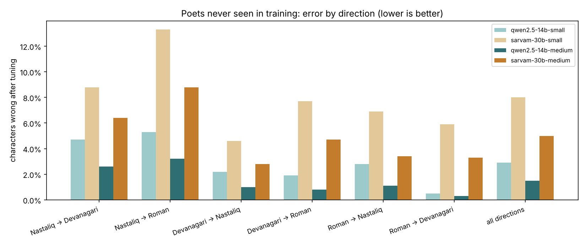
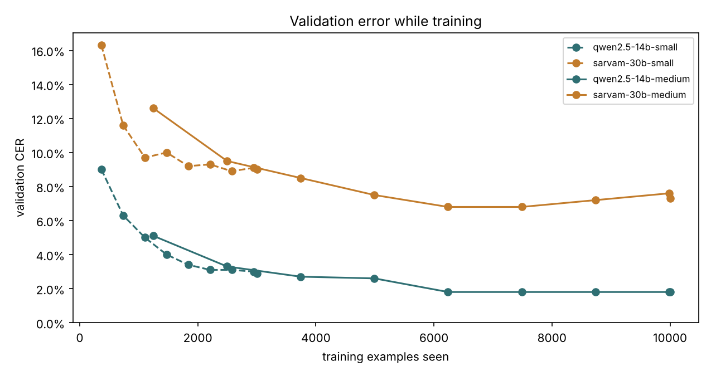

# Comparison

Familiar poets / poets never seen in training. CER = characters wrong (lower is better).

| Run | Training examples | CER before | CER after | Exact shers after | Radif kept | Qafiya kept | Training min |
|---|---|---|---|---|---|---|---|
| qwen2.5-14b-small | 3,000 | 25.1% / 23.3% | **4.3% / 2.9%** | 24.0% / 31.9% | 93% / 97% | 68% / 79% | 17 |
| sarvam-30b-small | 3,000 | 48.8% / 52.1% | **10.6% / 8.0%** | 5.8% / 11.0% | 87% / 90% | 49% / 58% | 99 |
| qwen2.5-14b-medium | 10,000 | 24.6% / 23.5% | **2.1% / 1.5%** | 48.1% / 54.8% | 97% / 98% | 81% / 88% | 43 |
| sarvam-30b-medium | 10,000 | 51.1% / 51.2% | **6.5% / 5.0%** | 13.9% / 21.8% | 90% / 93% | 56% / 68% | 304 |

## After tuning, by direction (poets never seen in training)

| Direction | qwen2.5-14b-small | sarvam-30b-small | qwen2.5-14b-medium | sarvam-30b-medium |
|---|---|---|---|---|
| Nastaliq → Devanagari | 4.7% | 8.8% | 2.6% | 6.4% |
| Nastaliq → Roman | 5.3% | 13.3% | 3.2% | 8.8% |
| Devanagari → Nastaliq | 2.2% | 4.6% | 1.0% | 2.8% |
| Devanagari → Roman | 1.9% | 7.7% | 0.8% | 4.7% |
| Roman → Nastaliq | 2.8% | 6.9% | 1.1% | 3.4% |
| Roman → Devanagari | 0.5% | 5.9% | 0.3% | 3.3% |
| all directions | 2.9% | 8.0% | 1.5% | 5.0% |

## Validation curves

